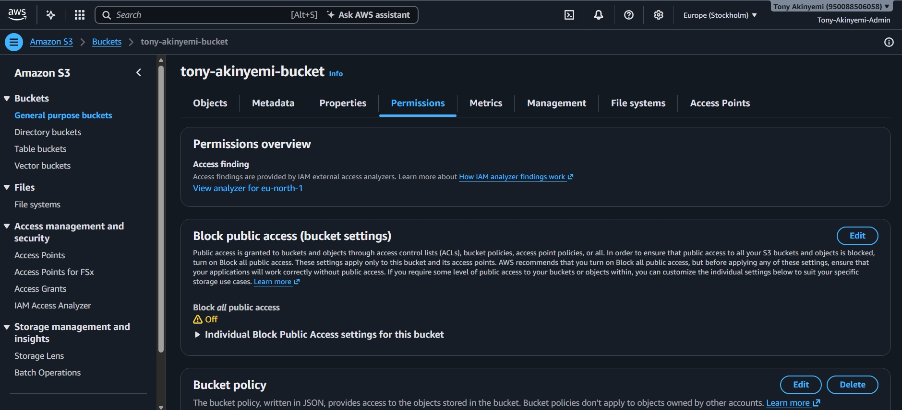
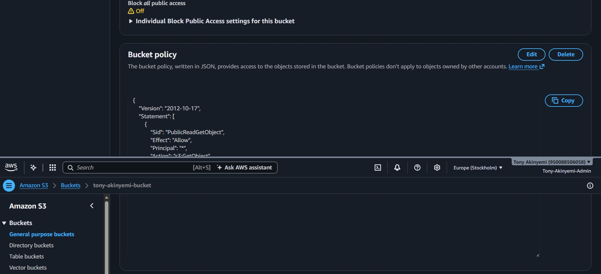
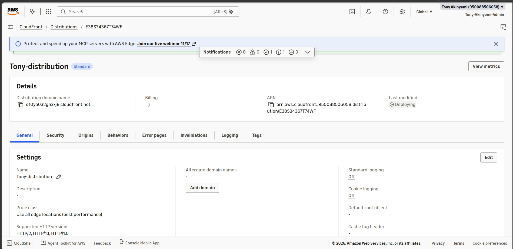
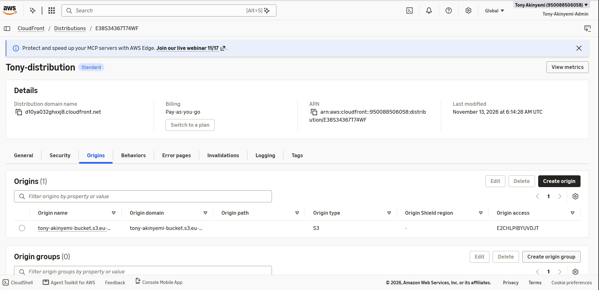
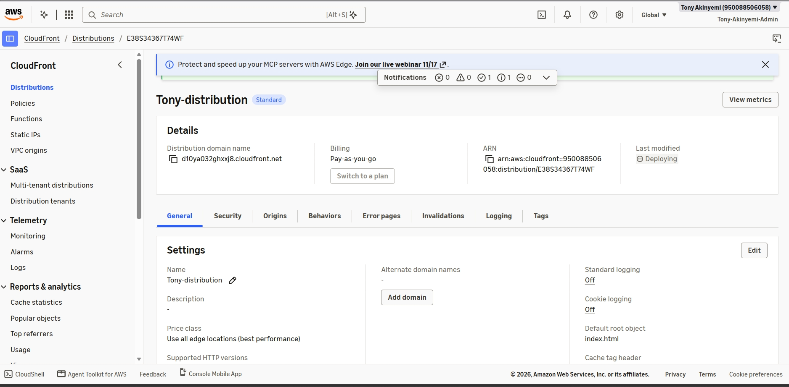

# Static Website Hosting Using Amazon S3 and CloudFront

## Project Overview

This project demonstrates how to host and deploy a static website using Amazon Web Services (AWS), specifically Amazon S3 and Amazon CloudFront.

The website files are stored in an Amazon S3 bucket, while Amazon CloudFront is used as a Content Delivery Network (CDN) to deliver website content to users efficiently.

## Project Objectives

The objectives of this project are to:

- Understand static website hosting.
- Create and configure an Amazon S3 bucket.
- Upload website files to Amazon S3.
- Configure Amazon CloudFront.
- Distribute website content through CloudFront.
- Understand the relationship between S3 and CloudFront.

## Technologies Used

**Technology**	            **Purpose**
- Amazon S3	                Stores website files and assets
- Amazon CloudFront	        Distributes website content globally
- AWS Management Console	Manages AWS resources
- Visual Studio Code	    Used for project documentation
- Git	                    Tracks project changes
- GitHub	                    Hosts the project repository

## Project Architecture

The project follows this basic architecture:

User → Amazon CloudFront → Amazon S3

- A user requests access to the website.
- CloudFront receives the request.
- CloudFront retrieves the website content from the configured S3 origin when necessary.
- CloudFront delivers the content to the user.

## Implementation Steps

Step 1: Create an S3 Bucket

An Amazon S3 bucket was created to store the static website files.

Step 2: Upload Website Files

The HTML, CSS, JavaScript and other required website assets were uploaded into the S3 bucket.

Step 3: Configure CloudFront

An Amazon CloudFront distribution was configured with the S3 bucket as its origin.

Step 4: Deploy the Website

The CloudFront distribution was enabled and allowed to finish deploying.
[click here to visit the website](https://d10ya032ghxxj8.cloudfront.net/)

Step 5: Test the Website

The CloudFront distribution domain name was used to access and test the deployed website.

## Project Screenshots

Amazon S3 Bucket

CloudFront Distribution

Live Website

## Project Information

- Project Name: Static Website Hosting Using S3 and CloudFront
- Cloud Provider: Amazon Web Services (AWS)
- Storage Service: Amazon S3
- Content Delivery Network: Amazon CloudFront
- Documentation Tool: Visual Studio Code
- Version Control: Git
- Repository Hosting: GitHub
- CloudFront URL: [https://d10ya032ghxxj8.cloudfront.net/]

## What I Learned

Through this project, I gained practical experience in:

- Creating and managing Amazon S3 buckets.
- Uploading and storing static website files.
- Understanding Amazon CloudFront.
- Configuring a CloudFront distribution with an S3 origin.
- Understanding how content is delivered through a CDN.
- Documenting cloud projects using Markdown.
- Using Git and GitHub for version control and project documentation.

## Conclusion

This project provided practical experience in deploying a static website using Amazon S3 and Amazon CloudFront.

It also improved my understanding of cloud storage, content delivery networks, website hosting and cloud infrastructure.

⸻

Author: **Tony Akinyemi**

Project: Cloud Computing Practical Assignment

Repository: [https://github.com/Tony-Akinyemi/s3-cloudfront-documentation.git] 